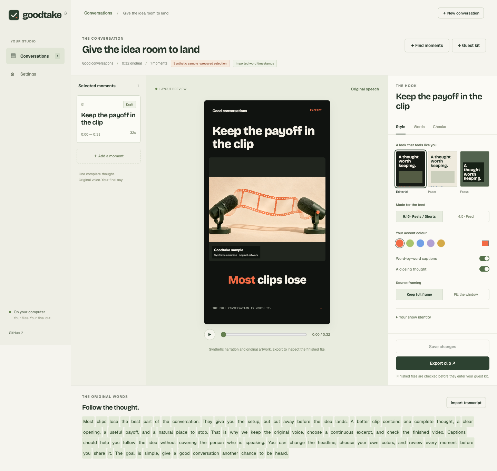
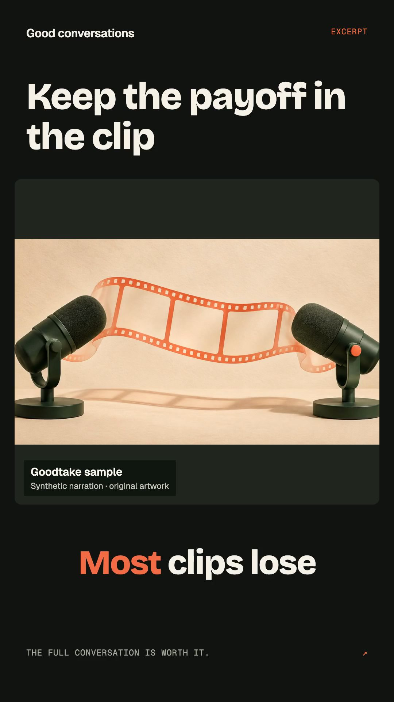
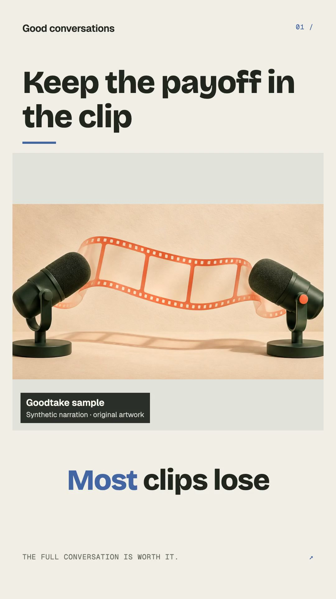
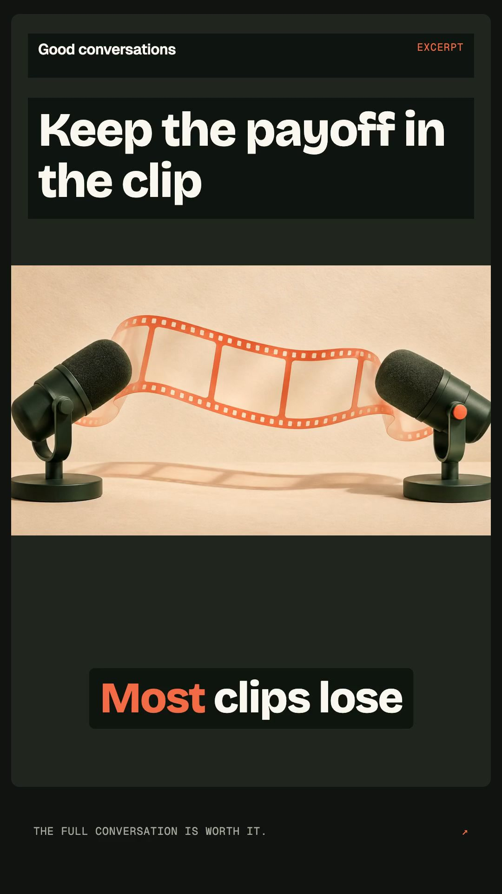

<p align="center"></p>

# Goodtake

**Give the idea room to land.**

An open-source, local-first podcast clipping studio. Find a complete thought, give it expressive
captions, make it look like your show, and check the finished file before sharing it.


[Start here](#start-here) · [Actual output](#see-the-output) · [Quality checks](docs/QUALITY.md) · [Contribute](CONTRIBUTING.md)

**v0.1 · early release.** The application code is MIT licensed. Rendering uses Remotion, which has
[separate license terms](THIRD_PARTY_NOTICES.md). Optional API providers bill your account.

## A good take is a whole thought

- **A clear opening and a real payoff.** Automatic selection receives a separate review grounded
  in the words inside the selected excerpt. Optional polish does not block usable clips.
- **Your original voice.** One continuous recording per clip. No rewritten speech, internal
  sentence splices, repeated cold opens or added synthetic narration.
- **Captions with intention.** Short word groups, active-word emphasis, punctuation-aware breaks,
  and three layouts: Editorial, Paper and Focus.
- **Your show, not ours.** Editable names, colours, headlines, copy, framing and end cards. True
  1080 × 1920 and 1080 × 1350 video layouts.
- **Checks on the finished file.** Encoded title/caption OCR, local speech comparison, prepared
  audio packet integrity, timestamps, loudness, dimensions and sampled picture checks.
- **A useful handoff.** Approve checked clips and download a guest kit with videos, covers, post
  copy and an offline gallery. Unapproved clips and full transcripts stay out of the kit.
- **Work you keep.** Local files, SQLite, a persisted queue, cancellation and content-bound render
  checkpoints. Matching retries repeat verification without encoding the same file again.



[Phone view](docs/assets/studio-mobile.png)

## Start here

### Docker: no Python or Node setup

Install Docker with Compose, then:

```bash
git clone https://github.com/1aday/goodtake.git
cd goodtake
docker compose up --build
```

Open **[127.0.0.1:3210](http://127.0.0.1:3210)** and choose **Try the sample**. The first build downloads
the renderer and system tools; the first local speech check also downloads a Whisper model.

Projects persist in the `goodtake-data` volume. The published port binds to loopback. This is a
personal local studio, not an authenticated public server. No API key is needed to load, style and
export the bundled sample. Connect providers through **Settings**, or copy `.env.example` to `.env`
before starting Compose.

### Native installation

Install **Python 3.11+**, **Node.js 22+**, **FFmpeg/FFprobe**, and **Tesseract with English OCR data**.
Check `python3 --version` first: older macOS Python installations are not sufficient.

```bash
git clone https://github.com/1aday/goodtake.git
cd goodtake
python3 -m venv .venv
source .venv/bin/activate
python -m pip install -e '.[local,youtube]'
goodtake doctor
goodtake setup
goodtake studio
```

On Windows, activate with `.venv\Scripts\activate`. Native production was checked on Apple Silicon;
use the Linux container as the more controlled starting point on other hosts. Windows native setup
still needs community verification.

The isolated Node renderer lives in the private data directory. Remotion detects/downloads Chromium,
or you can set `CHROME_PATH`. Native data defaults to `~/.local/share/goodtake`; use `--home /private/path`
to choose another directory. The packaged web app has no frontend build step.

## Make a clip

1. **Import** an original video or a YouTube conversation. Upload the original if YouTube blocks
   the download.
2. **Transcribe** with local Whisper, optional ElevenLabs Scribe, or imported word JSON/SRT. SRT
   word timing is explicitly approximate.
3. **Choose moments.** Add a continuous 5–180 second range yourself, or connect OpenAI to find
   25–180 second complete ideas. Adjust the range, headline and copy.
4. **Style and export.** Choose layout, aspect ratio, brand and framing. Follow real progress;
   failed checks are held for review rather than silently accepted.
5. **Watch and approve.** Approval puts a checked clip into the guest kit. Nothing posts to a
   social network automatically.

The Focus layout supports a manually positioned fill crop. This release does not claim automatic
speaker tracking. Keep the full frame for unfamiliar multi-speaker sources.

## See the output

These are real exports of the bundled synthetic sample: original artwork and AI-generated narration.
They demonstrate installation, layout and verification, not editorial performance on real podcasts.
Loading the sample uses a prepared transcript/selection and makes no API call.

| Editorial · 9:16 | Paper · 9:16 | Focus · 9:16 |
| --- | --- | --- |
| [](docs/assets/editorial-9x16.mp4) | [](docs/assets/paper-9x16.mp4) | [](docs/assets/focus-9x16.mp4) |

[Editorial 4:5](docs/assets/editorial-4x5.mp4) · [Actual encoded frames](docs/assets/editorial-9x16-frames.jpg) · [Verification record](docs/verification.md)

```bash
goodtake demo --render
```

The sample narrator is synthetic, not a real guest. See [provenance](THIRD_PARTY_NOTICES.md#the-bundled-sample).
Your own clips retain the source recording's speech; narration generation is not a production feature.

## Use the CLI

```bash
# Automatic: local transcription, OpenAI selection/review, local rendering/checks.
# Set OPENAI_API_KEY first, or save it in Settings.
goodtake produce interview.mp4

# Or control the individual steps.
goodtake import interview.mp4 --transcript interview.words.json
goodtake projects
goodtake add PROJECT_ID --start 42 --end 88 --title 'The decision that changed everything'
goodtake render PROJECT_ID
goodtake show PROJECT_ID

# Only after watching a checked clip:
goodtake approve PROJECT_ID --clip CLIP_ID
goodtake bundle PROJECT_ID
```

Progress goes to stderr; structured results go to stdout. `produce` prints the project ID before
paid work. A failed attempt can continue with `analyze PROJECT_ID` or `render PROJECT_ID` instead
of importing again. `render PROJECT_ID --clip CLIP_ID` explicitly rechecks an existing clip.

Word JSON is an array or an object with a `words` array. Preserve the actual recorded words:

```json
{"words":[{"text":"A","start":0.12,"end":0.28,"speaker":"0"},
          {"text":"thought.","start":0.29,"end":0.92,"speaker":"0"}]}
```

## Where data goes

| Action | Data path |
| --- | --- |
| Import, manual editing, local Whisper, rendering, OCR, final speech checks | Your computer |
| First renderer/model setup | Dependency/model downloads from registries |
| Automatic selection and editorial review | Transcript and selected written copy → OpenAI |
| Optional ElevenLabs transcription | Prepared source audio → ElevenLabs |
| Guest kit | Approved media and post copy → a local ZIP |

OpenAI requests set `store: false`; provider retention/account terms still apply. No telemetry or
automatic public sharing. Usage records contain reported tokens or audio duration and are explicitly
unpriced; this release does not invent a provider-invoice total.

## Architecture and development

Python owns the local API, SQLite queue, source acquisition, provider calls, selection and checks.
`goodtake/renderer/` is a separate Remotion adapter; it renders silent picture before FFmpeg muxes
the prepared continuous original-voice track. `goodtake/web/` contains the packaged browser app.
Provider keys, projects and generated exports belong outside the repository.

```bash
python -m pip install -e '.[local,youtube,dev]'
npm ci --prefix goodtake/renderer
python -m pytest
ruff check .
npm run typecheck --prefix goodtake/renderer
node --check goodtake/web/app.js
python -m build
python scripts/check-wheel.py
```

[Architecture decision](docs/decisions/2026-11-25-local-production.md) · [Contribute](CONTRIBUTING.md) · [Security](SECURITY.md)

## Current limits

- English typography/OCR is the verified path. Other speech languages are experimental; use a
  multilingual Whisper model and expect language-specific layout work.
- Up to three hours and 3 GB per source; one active production job. A lightweight moment editor,
  not a multitrack timeline.
- CPU and memory are used for rendering/recognition. No GPU is required. A sample run is not a
  general speed benchmark.
- At most four automatic drafts and two attempts to repair invalid reviewer evidence. Some
  conversations need manual selection; accepted moments survive later provider failures.
- Picture/caption checks sample frames and speech matching is statistical. These checks do not
  inspect every frame, prove every claim, replace creative approval or predict views.
- No public guest hosting, social publishing, generated guest portraits, automatic face tracking,
  desktop installer or completed competitor benchmark is claimed for this release.

## Make the next take better

Bring a caption failure, a clearer first-run experience, a distinctive template, or a well-scoped
provider adapter. Reproducible fixes and honest output comparisons matter more than promises of
guaranteed viral clips.

Goodtake grew out of a private podcast production workflow. It is independently packaged and
contains no private guest footage, credentials or deployment history. It is not a fork of AutoClip.
